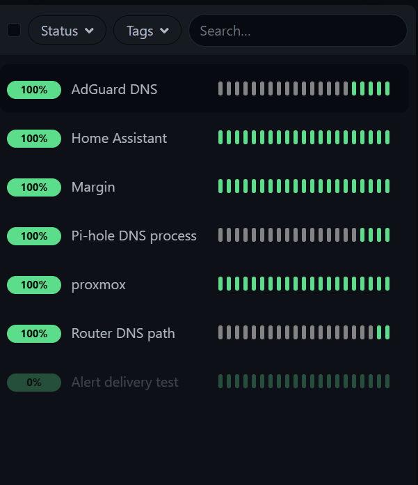

# AdGuard Home and Pi-hole automatic DNS standby

**Rollout completed November 13, 2026.**

The Dell runs AdGuard Home in a dedicated Debian VM on Proxmox VE. The Verizon router has AdGuard Home configured as primary DNS and Raspberry Pi Pi-hole as secondary. Pi-hole runs on separate hardware so the secondary can still answer when the Dell is unavailable. A Python controller on the Pi decides when to allow the router's DNS traffic to reach Pi-hole.

| Condition | What the controller does | Expected router DNS path |
| --- | --- | --- |
| AdGuard healthy | Renews a 30-second nftables rule that gates access to Pi-hole on the router forwarding path. | AdGuard Home |
| AdGuard stops responding | After 120 seconds of observed primary failure, removes the gate and lets queries reach Pi-hole. Loss of rule renewals also lets the lease expire. | Pi-hole can answer as the configured secondary |
| AdGuard returns | Waits for 300 seconds of observed healthy responses, then reapplies the gate. | AdGuard Home resumes primary filtering and Pi-hole returns to standby |

## How I operated and verified it

*November 13, 2026. All three DNS monitors were up after activation.*

1. Configured the router's primary and secondary resolvers and checked basic allow/block behavior on both.
2. Ran the Pi controller in observation mode before applying the firewall rule. Kept a manual availability mode so I could release the gate during maintenance.
3. Stopped AdGuard once under controlled conditions and reviewed 238 saved controller decisions. Measured the switch to standby and the return to primary using the first failed and first healthy observations.
4. Activated automatic mode and checked that the timed rule was present, the router answered DNS queries over IPv4 and IPv6, and the controller was enabled at boot. Added Uptime Kuma monitors for AdGuard DNS, the Pi-hole DNS process, and the router DNS path. Verified phone notification delivery.

5. On November 14, shut down the Dell cleanly and powered it back on. Pi-hole logged and forwarded both test queries sent to the router over IPv4 and IPv6 while the Dell was off. After restart, AdGuard logged both new test queries and the controller reapplied the standby gate.

The November 13 trial stopped the AdGuard service. The November 14 test covered graceful shutdown and restart of the entire Proxmox host. See the [validation timeline](VALIDATION.md) for measured intervals.
