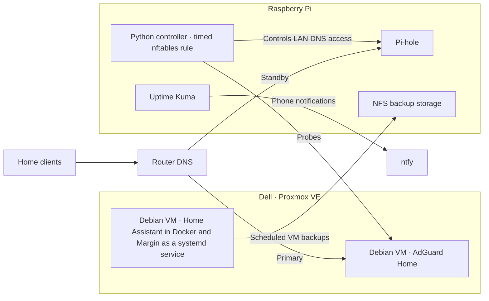

# Proxmox Homelab Migration and DNS Recovery

I repurposed a Dell Pro Slim desktop as a bare-metal Proxmox VE host in October 2026 to give my household applications and primary DNS separate VMs. I moved Home Assistant and Margin into a Debian VM and set up AdGuard Home in its own VM. The Raspberry Pi stayed independent of the Dell to provide standby DNS, off-host backups, and monitoring during a Dell outage.

- **Migration:** Rechecked both applications after a VM reboot and tested private HTTPS access to Margin over Tailscale from cellular.
- **Recovery:** Ran scheduled backups to Raspberry Pi NFS storage and restored a backup into a separate test VM. Application-level recovery from that VM remains open.
- **DNS:** Verified failover and failback during a graceful Dell shutdown and restart on November 14, 2026. The router forwarded test queries to Pi-hole while the Dell was off and to AdGuard Home after recovery.

## What I built and checked

| Workstream | Implementation | Validation |
| --- | --- | --- |
| Service migration | Moved Home Assistant and Margin into a Debian VM. Kept the old Pi copies available for rollback. | Checked Home Assistant and Apple Home controls, Margin data, and both applications after a VM reboot. Checked private HTTPS access to Margin over Tailscale from cellular. |
| Backups and alerts | Scheduled Proxmox backups to Pi-hosted NFS storage with seven retained backups. Set up Uptime Kuma and ntfy on the monitoring path. | Recorded a successful scheduled backup and receipt of its report. A disposable listener test delivered both down and recovery alerts to my phone. Full application verification from the restored VM remains open. |
| DNS standby | AdGuard Home runs in a dedicated VM. A Python controller on the Pi probes DNS and renews a 30-second firewall rule while the primary is healthy. | During the November 14 host test, the controller released standby after 120 seconds. Resolver logs confirmed the IPv4 and IPv6 router test queries reached Pi-hole while the Dell was off and AdGuard after recovery. |

## Design decisions

- I used a dedicated DNS VM to manage AdGuard separately from the application guest. Keeping Pi-hole on separate hardware gives the standby its own host.
- I kept monitoring and control independent. Kuma sends alerts, while the Pi controller makes DNS decisions from its own probes. A missed phone alert cannot prevent the controller from acting.
- I gave the firewall rule an expiration time so a stopped or stalled controller would eventually release the gate. I also kept a manual override to make Pi-hole available during maintenance.

[See how AdGuard Home and Pi-hole switch over and back](DNS-STANDBY.md). [Read the migration checks and outage timeline](VALIDATION.md).
