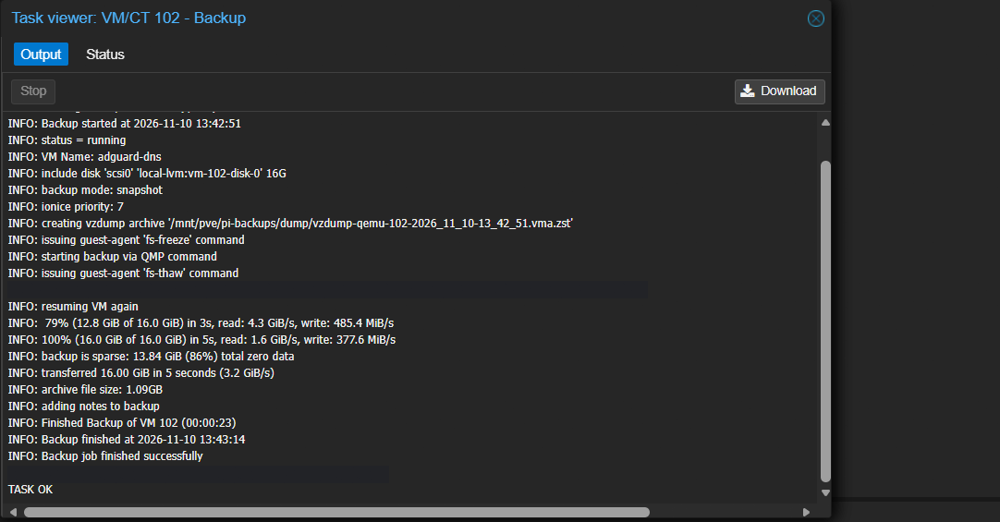
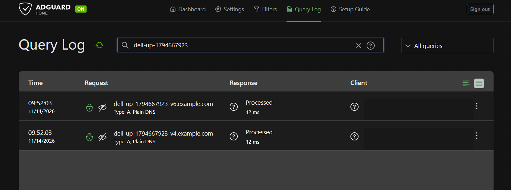

# Migration and DNS validation

## Migration sequence

1. **October 2026:** Preserved the former Windows desktop files and Hyper-V export before repurposing the Dell. Confirmed Proxmox booted from the internal drive after removing the installer USB. Proxmox Manager 9.2.24 was recorded on October 29, and the Debian 13.7 application guest was verified on October 30.
2. **October 31–November 4:** Moved Home Assistant and Margin in stages, retaining the old Pi copies for rollback. Checked a separate Margin data restore before cutover, then rechecked the migrated applications after a guest reboot. Verified private access to Margin over cellular with Tailscale.
3. **November 5–10:** Restored a VM backup to a separate test guest. Verified a scheduled application VM backup and a DNS VM snapshot backup on Pi-hosted NFS. A disposable listener test delivered both down and recovery phone alerts. Full application validation inside the restored VM remains open.
4. **November 11–13:** Ran an observation-only baseline against both DNS resolvers, tested the installed standby controller during one planned outage, and then activated automatic standby and added DNS monitors.

The rollout closed on November 13. The final activation output recorded an active systemd service enabled at boot, automatic mode, a live timed firewall rule, successful router DNS checks over IPv4 and IPv6, and `ACTIVATION PASS`. Three Uptime Kuma DNS monitors showed Up, and I confirmed that the notification test reached my phone. [Read the DNS design and operating sequence](DNS-STANDBY.md).

*November 10, 2026. Proxmox reported TASK OK for the AdGuard VM snapshot backup.*

## Controlled DNS outage

The test asked when the installed controller would open standby access after losing AdGuard and when it would close that access after recovery. The observation-only baseline had logged 960 DNS probes across 120 rounds in 20 minutes, all successful. The later outage trial intentionally stopped AdGuard once. The saved outage journal contains 238 controller decisions across the trial and cleanup. Its SHA-256 checksum matched the recorded checksum when checked during case-study preparation.

| Event | Elapsed time |
| --- | --- |
| AdGuard stopped → first failed primary observation | 3 seconds |
| First failed observation → controller released standby access | 120 seconds |
| AdGuard restarted → first healthy observation | 2 seconds |
| First healthy observation → controller reapplied the gate | 300 seconds |

The failure window lets the controller tolerate a short interruption before opening the standby. The longer recovery window lets it observe a stable primary before gating standby traffic again. The timer on the firewall rule independently bounds how long a rule can remain in effect without renewal.

## Whole-host failover and failback — November 14, 2026

After a graceful Dell shutdown, the controller went from its first failed observation at 09:36:37 EST to releasing Pi-hole access at 09:38:37, 120 seconds later. While the Dell was off, two test queries sent to the router over IPv4 and IPv6 received replies in 16 ms and 12 ms. Pi-hole logged both unique requests and forwarded them upstream.

After physical power-on, the application and DNS VMs were reported running and the restore-test VM stopped. The controller returned from recovery wait to primary stable after 310 seconds. At 09:52:03 both router probes received replies in 16 ms, and the AdGuard Home query log shows both requests with 12 ms processing time each. The timed gate was present. I confirmed Home Assistant worked and Margin loaded the expected data.

*November 14, 2026. AdGuard Home processed both post-restart test queries at 09:52:03 EST.*

## Evidence boundaries

- November 14 added resolver-log evidence for two router queries while the Dell was off and two after failback. The shutdown was graceful and the Pi stayed running.
- The tested gate covered the router's IPv4 forwarding path to the Pi, including queries sent to the router by IPv6 clients. Direct queries to the Pi over native IPv6 were outside its scope.
- Abrupt power loss and a Pi reboot remain outside the November 14 test scope.
- The application reboot, cellular access, and phone alert checks came from the operator's recorded checks. The controlled outage timing came from the saved journal. No new lab tests were needed to assemble this case study.
